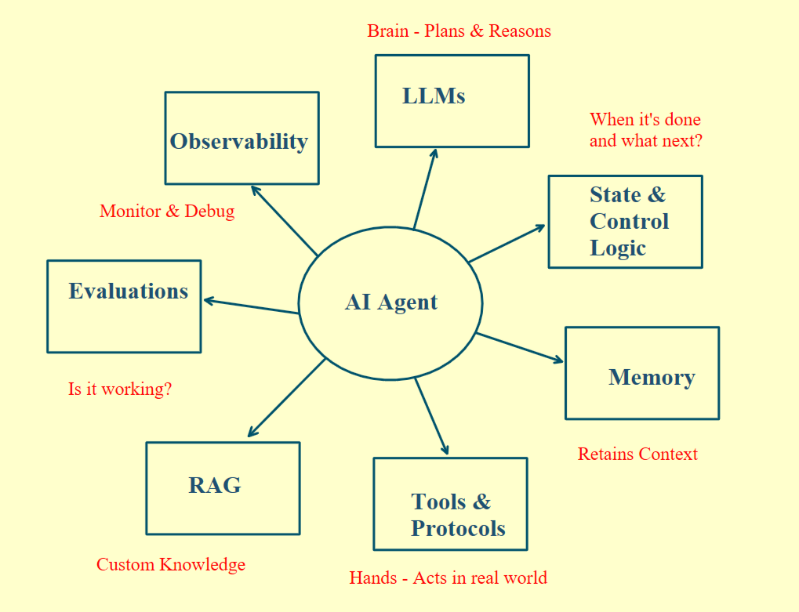
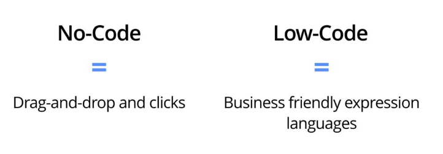

# 01 · What is Agentic AI?

## Generative AI vs Agentic AI

Generative AI understands and generates text, images and video. Ask it to plan a trip and it gives you an itinerary. It can't book the tickets.

Agentic AI closes that gap between generating and doing. It plans, executes and completes the task end to end.

|                  | Generative AI                                  | Agentic AI                                         |
| ---------------- | ---------------------------------------------- | -------------------------------------------------- |
| What it does     | Understands and generates text, images, video  | Plans, executes and completes the task end to end  |
| Plan a trip      | Gives you an itinerary                         | Books the tickets                                  |

## What an agent is made of

  

- **LLM.** The brain. It plans how to break a goal into multiple steps.
- **Tools.** APIs, databases and functions the agent calls to take an action, like booking tickets or sending emails.
- **Memory.** Keeps the context so the agent doesn't forget it in the middle of a task.
- **Control logic.** Decides what to do next and when the task is done.

You can add more layers, such as RAG, evaluations and observability, depending on how you want the agent to work.

Together, these make the system goal-driven. It takes the action instead of telling you how to complete it.

## Why not start with no-code or low-code platforms

When you build your first agent, most tutorials point you to no-code and low-code tools like n8n, or frameworks like LangGraph.

  

Most agents built this way aren't usable at real production scale:

- **Lock-in.** If something goes wrong inside their framework, you're stuck until they fix it.
- **Their design may not fit yours.** Their way of handling context, memory and tool schemas might not fit your constraints. That burns tokens, money and time.
- **Security.** Most of these platforms don't let you control security at all.

## Build your own agent

When you build from scratch, every function and every breakpoint is yours. You get full observability and control, and the system is designed exactly for your problem.
