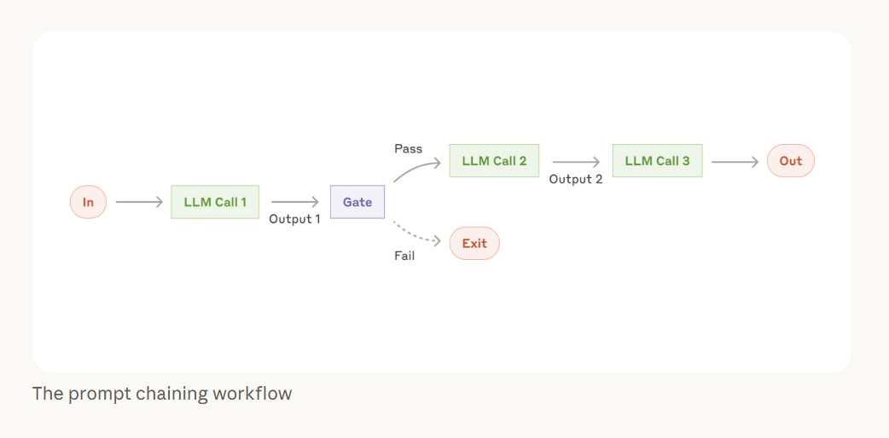
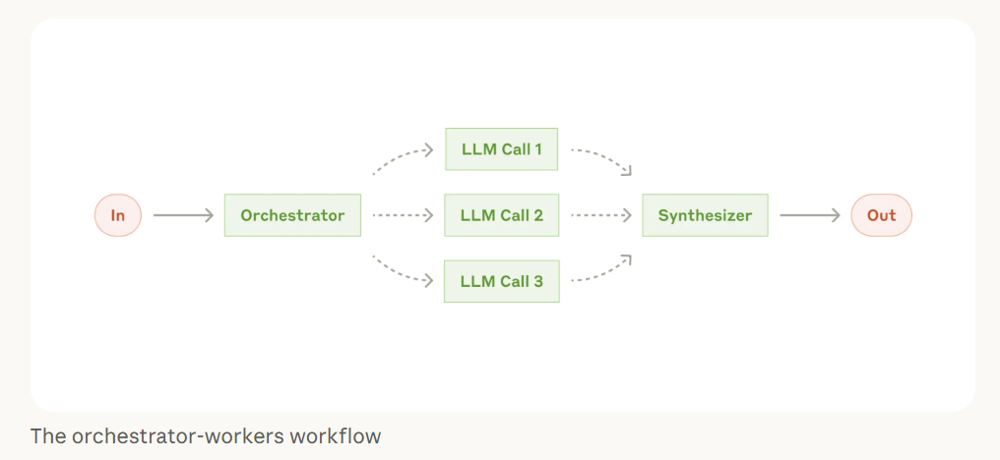
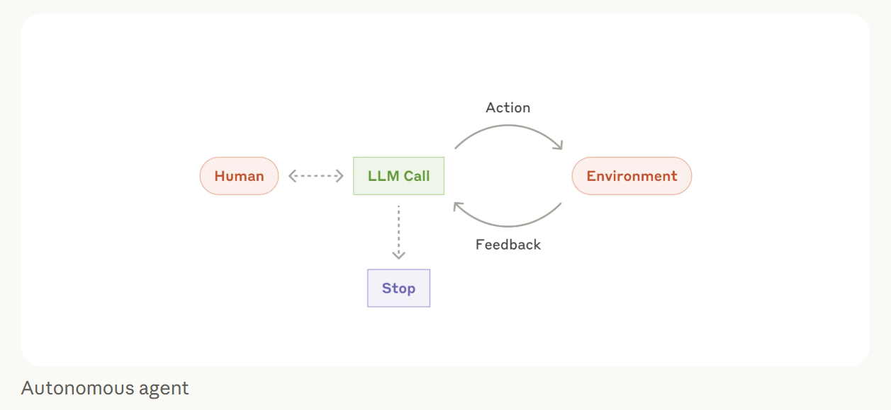
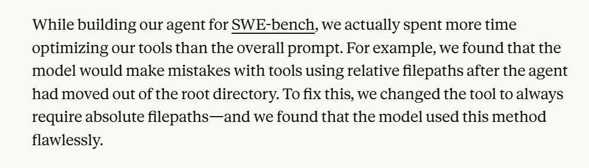

# 02 · Building Effective Agents

## Start simple

Anthropic studied dozens of AI applications in production. They recommend starting with the simplest solution possible and adding complexity only when it's needed.

Jumping straight to a complex multi-agent system makes everything harder for no reason.

## Workflows

Most problems don't need an agent. They need a workflow, where the LLM follows a predefined path and you stay in control.

### Prompt chaining

Break a task into a sequence of steps. Each LLM call handles one step and passes its output to the next. One LLM trying to do everything at once gives you mediocre output.

  

### Orchestrator-workers

A central LLM dynamically breaks down the task, delegates each part to worker LLMs and synthesizes the results.

  

## Agents

If workflow patterns don't fit your problem, that's when you need an agent.

The LLM sits in a loop. It takes an action, observes what happened in the environment and decides the next action based on that feedback, until the task is done.

  

## Tool design

Tool design can make or break your agent in production.

  

Anthropic's own team spent more time optimizing tools than the agent prompt to eliminate failures.

  

If your tools are poorly defined, your agent will misuse them consistently. Write every tool definition like an explainer for a junior engineer. Include examples, edge cases, the input format and clear boundaries.

## Further reading

[Building effective agents](https://www.anthropic.com/research/building-effective-agents) by Anthropic. The workflow and agent diagrams and the SWE-bench excerpt are from this guide.
