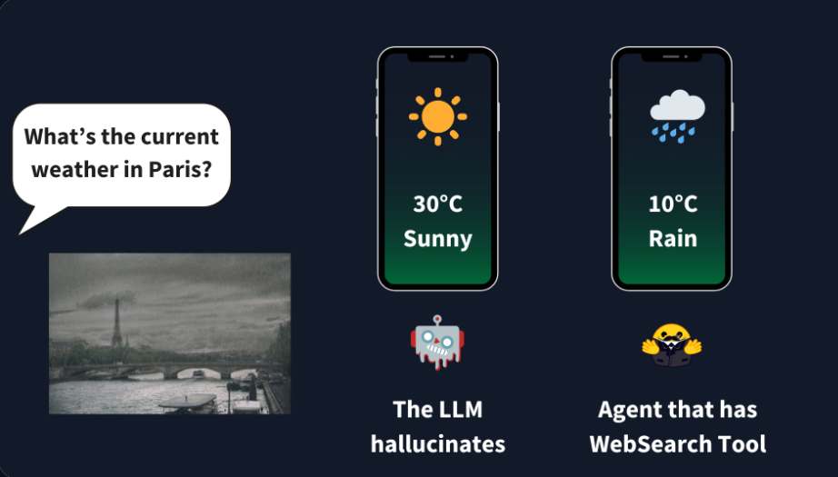
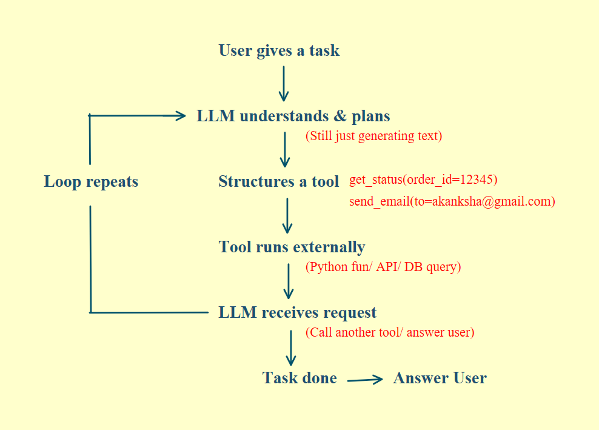
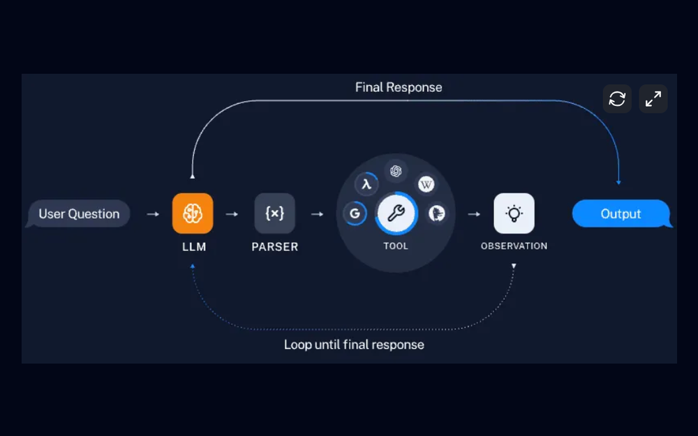
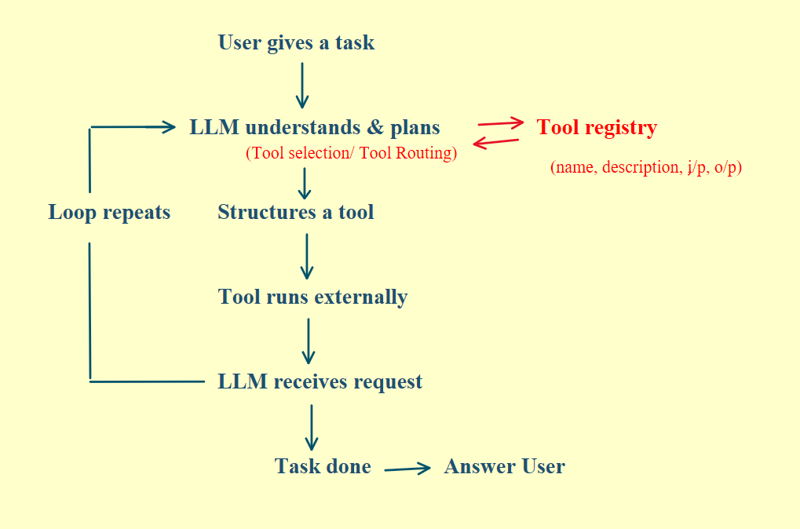
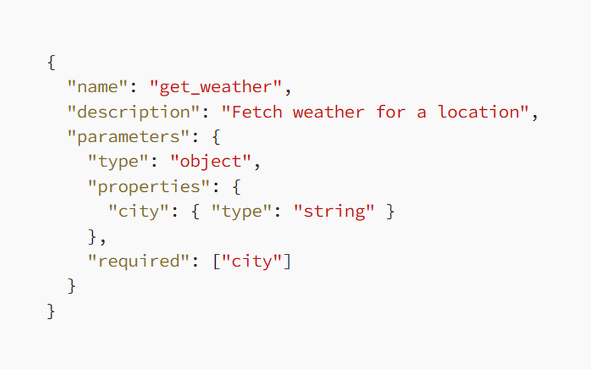

# 03 · Tools and Tool Calling

## Why agents need tools

An agent isn't powerful if it can't interact with the real world, which means acting and doing things. That ability to act comes entirely from tools.

LLMs predict text based on their training data, so their knowledge has a cutoff. Ask one about yesterday's stock price and it doesn't know. Tell it to update a record in your database and it can't touch it.

  

## What tools are

A tool is anything your LLM can invoke to interact with the outside world: an API, a database query or an internal function written in code.

Give an LLM tools and generation turns into execution. Instead of only answering, it does the work.

## How an agent uses tools

1. The user gives a task.
2. The LLM understands it and plans.
3. It structures the plan into a tool call, such as `get_status(order_id=12345)` or `send_email(to=akanksha@gmail.com)`.
4. The tool runs externally (a Python function, an API call or a database query) and returns a result.
5. The LLM looks at the result and decides whether to call another tool or answer the user.
6. The loop continues until the task is done.

  

The LLM is still only generating text. That text gets structured and executed externally through APIs, functions or database queries. The results come back in and the cycle repeats. That loop of reasoning and action is what makes it an agent.

  

## How the LLM knows which tool to use

You maintain a tool registry. Every tool in it has a name, a description of when to use it, input parameters and expected output.

The LLM gets this metadata and uses it to reason about which tool to call and how. This is tool selection, also called tool routing.

  

An example tool definition:

  

