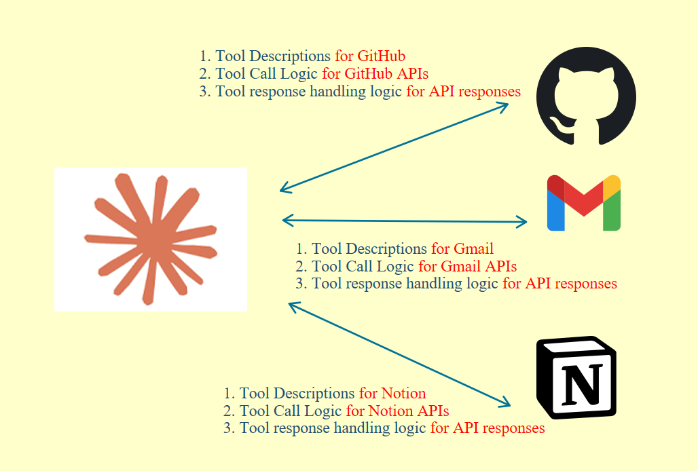
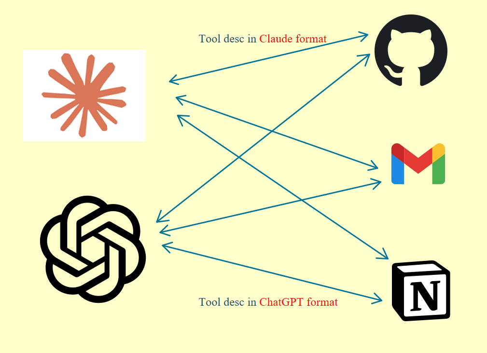
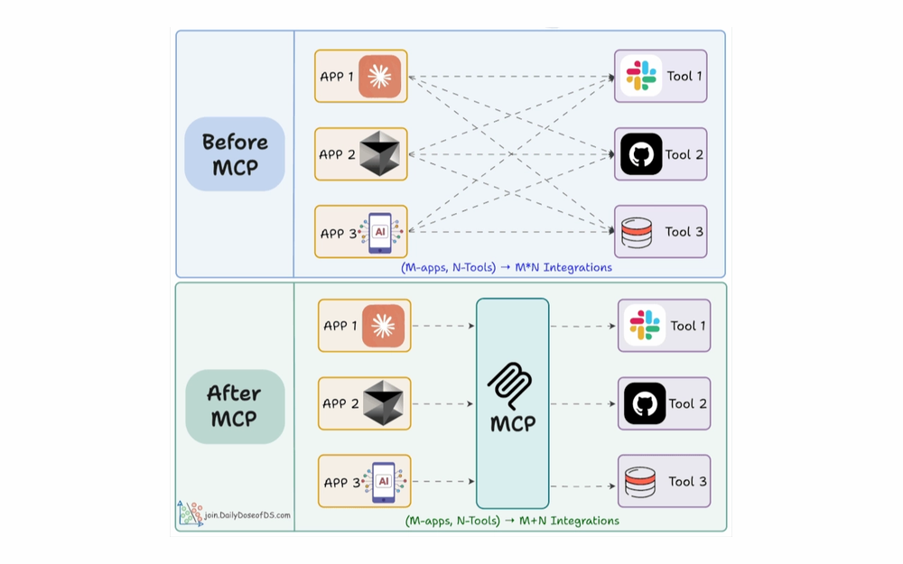
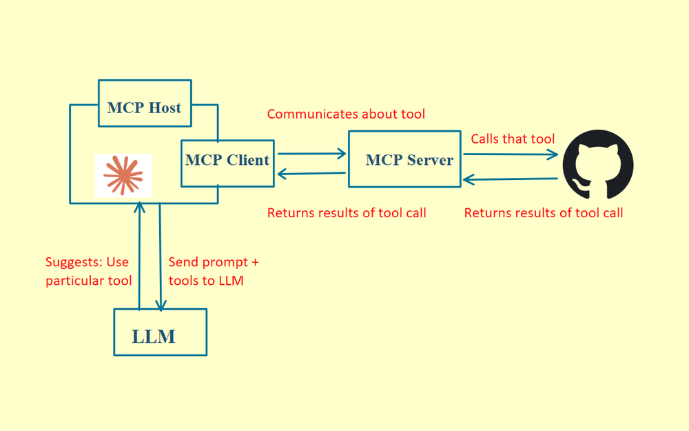
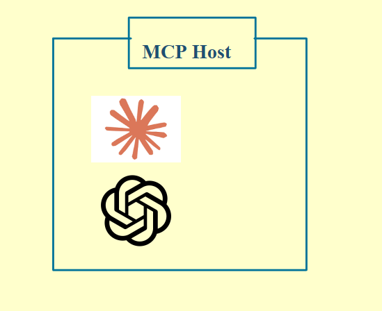
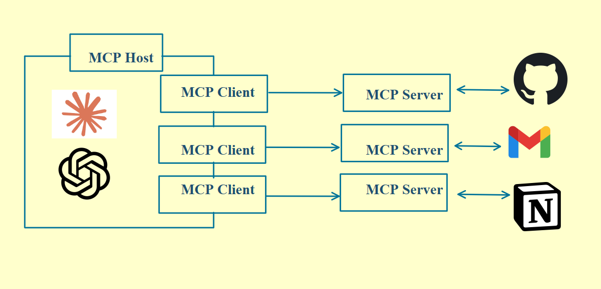
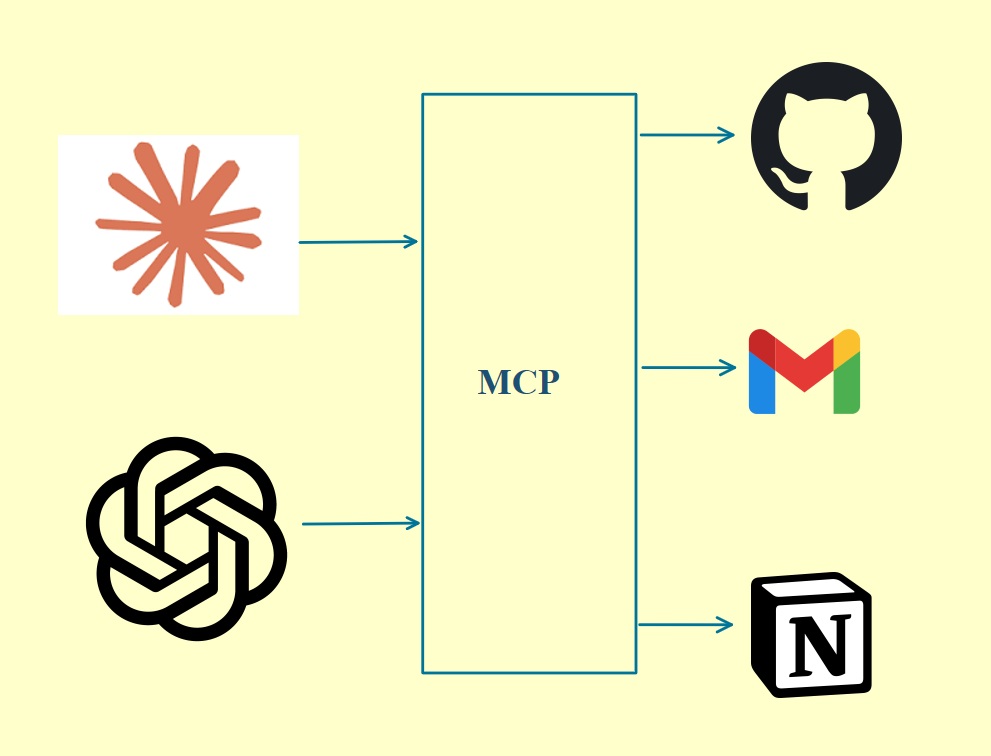

# 04 · Model Context Protocol (MCP)

For AI to do things in the real world, it needs tools. Connecting every tool to every model from scratch is painful. MCP is the better way.

## The M×N problem

To connect one tool to your AI, you build three things:

1. A description of what the tool does, so the model understands it.
2. The code that calls the tool's API.
3. The handling for what comes back.

Want to connect Gmail? Same three things. Notion? Same three things again.

  

If you switch AI apps, say ChatGPT instead of Claude, each one has its own format for tool descriptions. You can't reuse any of it, so you start over. Want ChatGPT to talk to GitHub? Build all three. Want Claude to do the same? Build all three again.

  

Two models and three tools means six separate integrations to build and maintain. That's the M×N problem, and MCP turns it into M+N.

  
   
  Image: Daily Dose of Data Science

## How MCP works

  

### MCP host

The host is your AI app, like Claude Desktop or Cursor. It's the entry point. You send a prompt, the model decides which tool it needs, and the host hands the call off.

  

### MCP client

The client lives inside the host and maintains the connection to the server. It fetches the tool descriptions, forwards the tool calls and gets the results back. It holds no logic and runs nothing. It's only the pipe.

  

### MCP server

Before MCP, all the tool logic lived inside your app, and you were the middleman. GitHub's API calls and the response handling all sat in your code.

The MCP server pulls that out. GitHub publishes one MCP server with the tool descriptions and API code bundled together. Your app connects to it and everything flows automatically. Instead of writing the GitHub connector yourself, you use one that already exists.

The connector code that used to live inside every app is now one standalone process, and any AI app can point to it and use it. Tool owners publish their server once, and nobody else has to write that integration again.

## Build once, connect everywhere

MCP is an agreed standard. Instead of every AI app building its own connector to every tool, you build one MCP server per tool, and any app that speaks MCP can connect to it. M×N becomes M+N.

  

REST APIs became the standard for the web and USB became the standard for hardware. MCP is that standard for AI agents.
