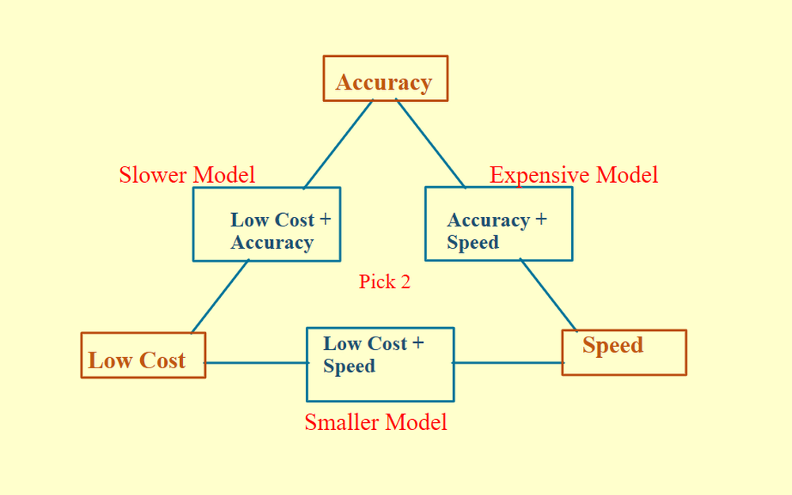
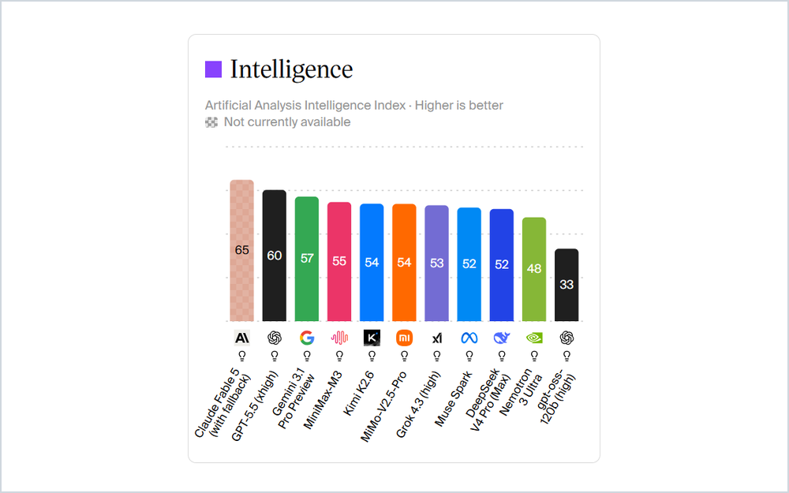
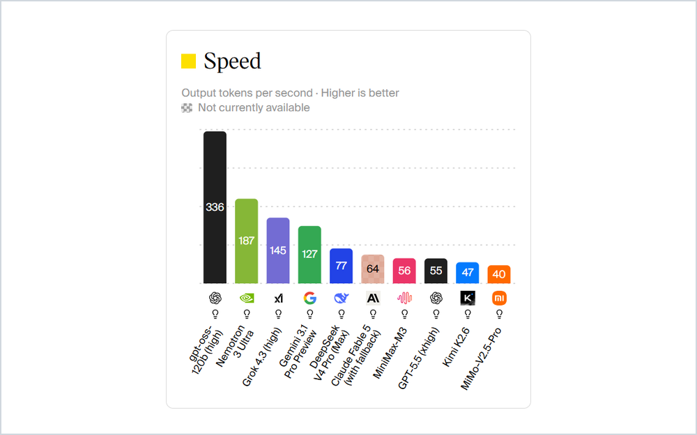
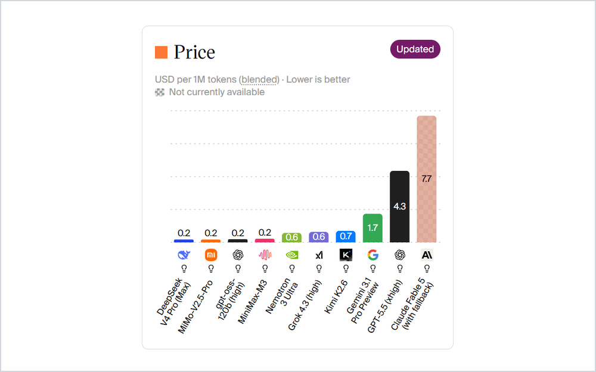
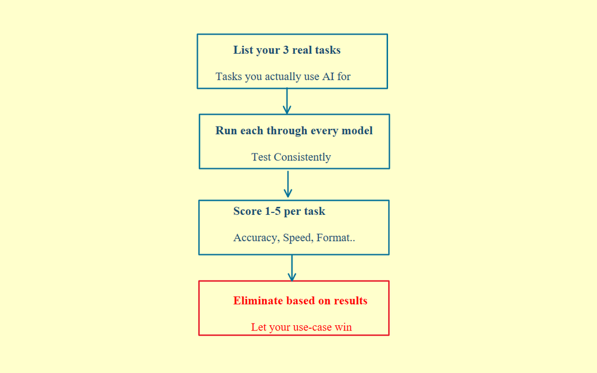

# 06 · Choosing the Right Model

There are thousands of AI models out there, and new ones drop every week. To pick the right one for your AI application, evaluate three things: your budget, your tradeoffs and your own evals.

## Step 1: Consider your budget first

Your budget tells you whether open-source models are even on the table.

Open models like Mistral or Llama give you self-hosting, fine-tuning and full control over everything. But they're a heavy lift. You need infrastructure, people who understand model internals, uptime monitoring and rollback systems. Unless you have strong domain constraints and an experienced infra team, it's usually not worth it.

Closed models are much easier to integrate and let you move fast, especially at an early stage.

If your budget is tight, self-hosting is basically off the table.

## Step 2: Consider the tradeoffs

Once you know your budget, figure out your real priority: cost, speed or accuracy. Think of it as a triangle. You rarely get all three.

  

| If you want                  | You need                                                      |
| ---------------------------- | ------------------------------------------------------------- |
| High accuracy + low latency  | An expensive model                                            |
| Low cost + high accuracy     | A slower model, run in batches                                |
| Low cost + low latency       | A smaller model, with your prompting doing the heavy lifting  |

Most people start at the top of this triangle and only scale down once they hit a wall in production. It's better to start from your constraints and only go up if your evals force you to.

A few things to keep in mind:

- **Skip reasoning models at first.** Most tasks don't need one. They're slower and more expensive, and for most use cases the gains aren't that big. Treat reasoning as a later optimization.
- **Try small language models.** They're underrated for focused tasks.
- **Don't fine-tune until you've exhausted prompting and RAG.** Fine-tuning brings cost, lock-in and maintenance you didn't ask for.
- **Don't lock yourself in early.** Start prototyping with anything and switch later based on evals.

## Step 3: Run your own evaluation

Benchmarks measure real things. But pricing, rate limits, context windows and even response style often matter more than a few points on a leaderboard.

  
  
  
   
  Images: Artificial Analysis

Here's what works:

1. List the 3 tasks you actually use AI for. Use your real tasks, not generic ones.
2. Run each one through every model you're considering.
3. Score each model 1 to 5 per task on whatever matters to you, like accuracy, speed or format. Be consistent across every model.
4. Eliminate models based on your results, and let your use case win over the leaderboard.

  

Your constraints should define your choice, more than any benchmark, a friend's recommendation or whatever's trending.
