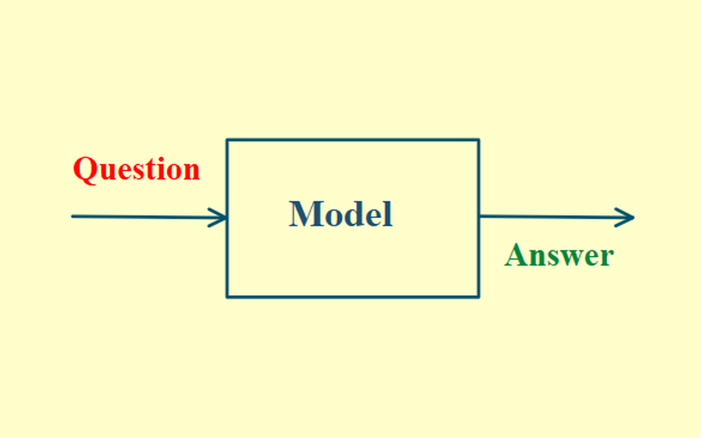
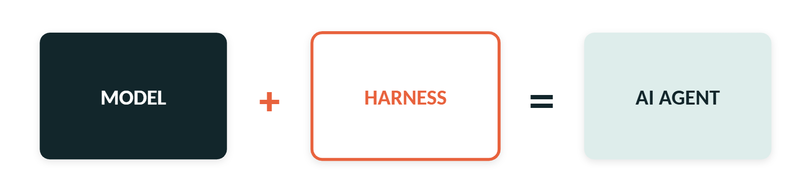
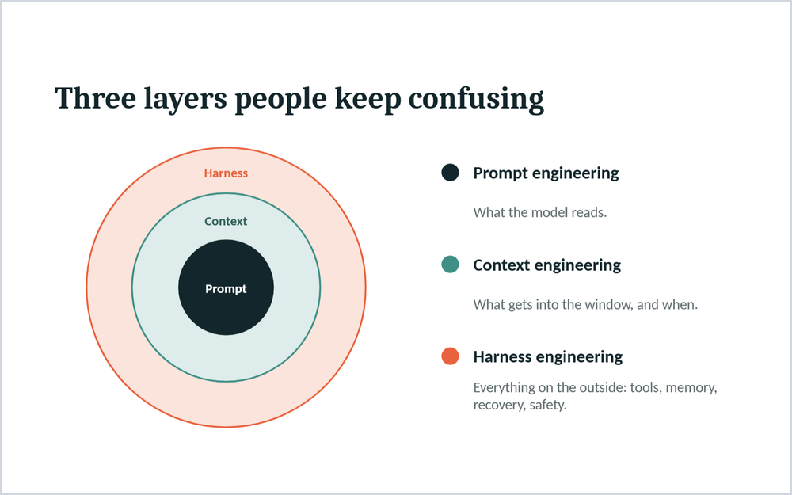
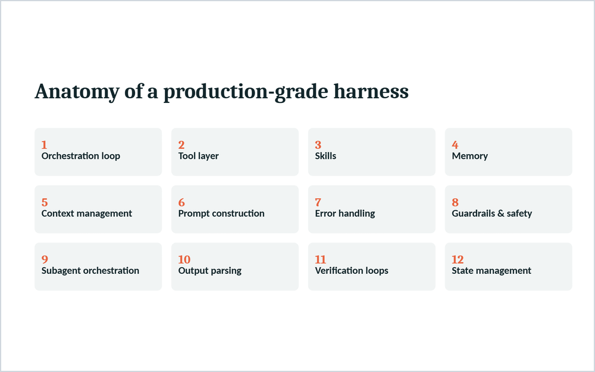

# 07 · Harness Engineering

## A model alone isn't an agent

A model on its own can only answer a question. It can't remember what happened two steps ago. It can't run code, pull real-time data, install a package or recover when something fails halfway.

  

Every capability you think of when you hear "powerful agent", like memory, tool use and error recovery, comes from the infrastructure wrapping the model. That infrastructure is called the agent harness. Engineering it deliberately is called harness engineering.

AI agent = model + harness. If you're not the model, you're the harness.

  

Cursor, Claude Code and Codex are each a harness built around a model.

## Prompt, context and harness engineering

People often confuse these three layers:

| Layer               | What it covers                                                                                                   |
| ------------------- | ---------------------------------------------------------------------------------------------------------------- |
| Prompt engineering  | What the model reads                                                                                             |
| Context engineering | What gets into the context window, and when                                                                      |
| Harness engineering | The whole application infrastructure: tool execution, state persistence, error recovery, verification, safety and more |

  

## Anatomy of a production-grade harness

  

1. **Orchestration loop.** Keeps the model running, calling tools and feeding results back until the task is done. The harness decides when to stop: no tool calls are left, the turn limit is hit, the token budget runs out or a guardrail trips.
2. **Tool layer.** A tool is a JSON schema telling the model what it can call, plus the code that runs when it does. More tools make the agent worse, so give it only the few it needs.
3. **Skills.** Your team's rules, written in Markdown files like `CLAUDE.md` and injected into the prompt. This is how you turn a generic harness into one that follows your conventions.
4. **Memory.** Models forget everything after each turn. Memory fixes that, with short-term memory in the context window and long-term memory in a vector database. Done well, it saves a huge amount of context tokens.
5. **Context management.** Models get worse as input grows, and they lose the middle first, before they hit any token limit. So you summarize old turns, hand heavy work to subagents and keep a running `todo.md` to stay on track.
6. **Prompt construction.** The system prompt isn't one fixed string. It's assembled every turn. Keep the stable parts first and the changing parts last. Otherwise you break the cache and can 10x your inference cost.
7. **Error handling.** Steps fail, and failures pile up fast across a long task. Catching and recovering from them is the harness's job, not the model's.
8. **Guardrails and safety.** The model decides what to attempt, and the harness decides what's allowed. Safe commands like `ls` run freely, while dangerous ones like `rm -rf` get blocked.
9. **Subagent orchestration.** Every time one agent hands work to another, some context is lost in the handoff. You can't avoid that, so design around the information loss.
10. **Output parsing.** Modern harnesses read the model's output as clean, validated JSON instead of running regex on plain text. Tool calls mean the loop continues, no tool calls mean it's the final answer, and a bad format gets sent back to the model to fix.
11. **Verification loops.** Letting an agent check its own work improves quality 2-3x, according to the people who built Claude Code. The gain comes from running real tests and feeding the failures back, not from better prompting.
12. **State management.** If your agent crashes at turn 30 of 60, this decides whether you lose everything or resume in seconds. It covers checkpointing, event logs and replaying exactly what happened.

## Is this just system design?

Pretty much. If you're building AI agents, these concepts should already sound familiar. Harness engineering is a new name for the system design and engineering around the model.
