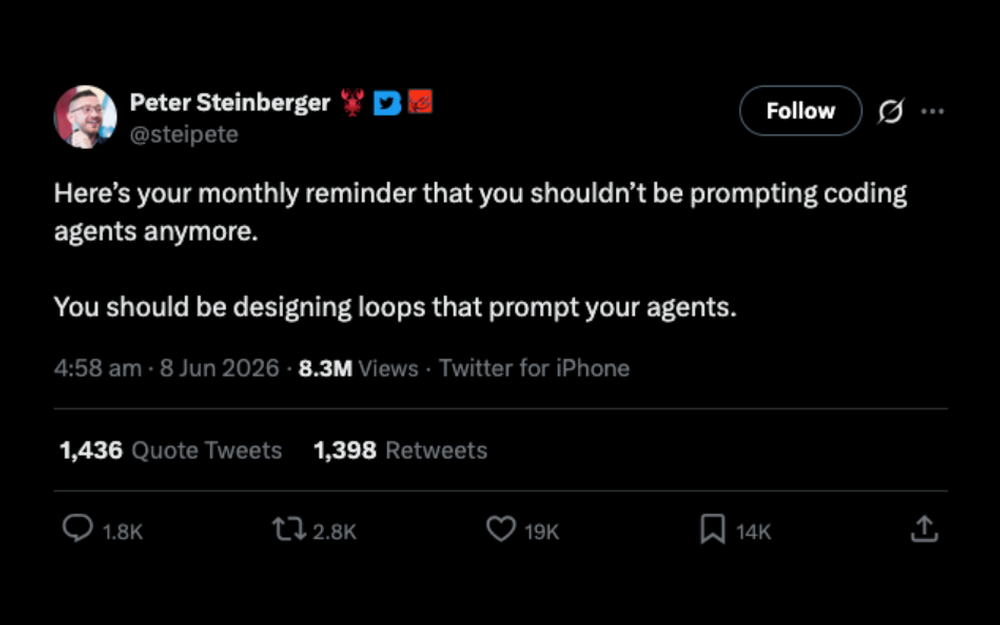
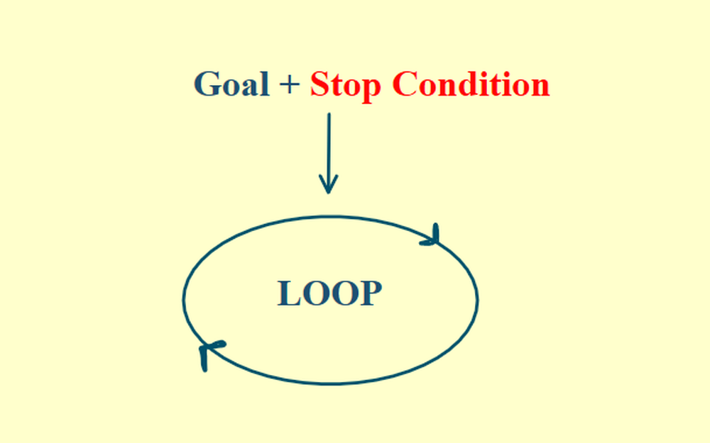
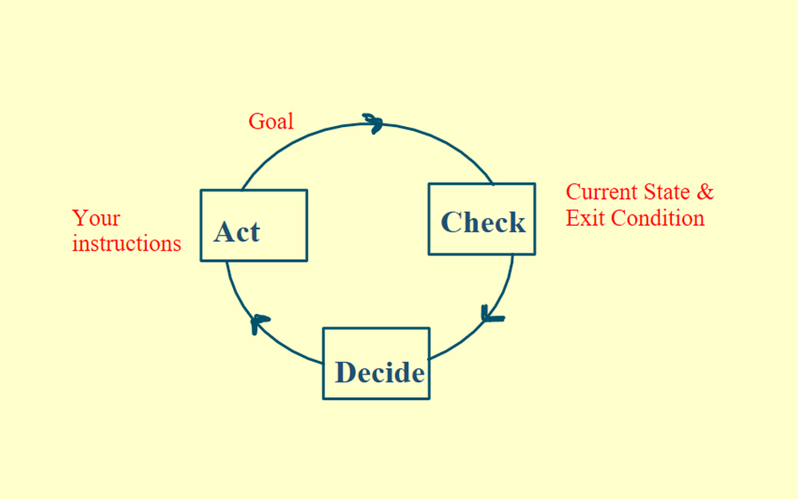
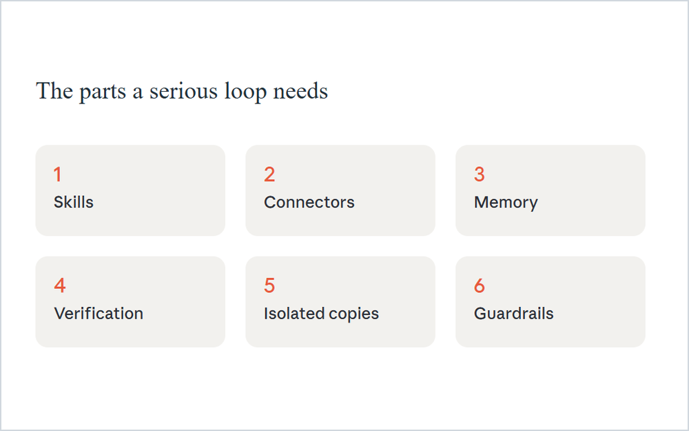
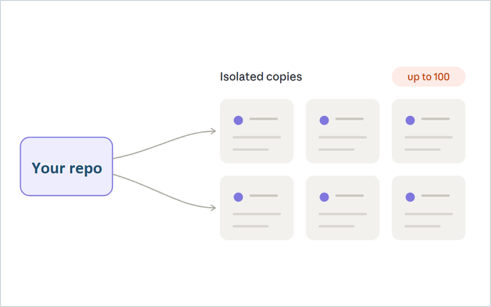

# 08 · Loop Engineering

Everyone's talking about loop engineering.

  
   
  Post by Peter Steinberger (@steipete)

Most people don't understand how to write a great loop, or when not to use one at all.

## From turns to loops

The old way was turn-based. You prompt the system, it gives you an output, you check it, and then you write the next prompt. That's fine for small tasks, but it's a problem for long-running ones.

A loop fixes that. You set the goal once and define a stopping condition. An orchestrator then keeps prompting the system based on the current state of the work.

  

The orchestrator looks at the state, decides the next move, checks it and decides whether to keep going, until it hits your stopping condition.

  

## Prompt engineering moved to the start

Even a fully automated loop is still being prompted, so prompt engineering isn't dead. It moved to the very beginning, since the entire loop runs on that first prompt. If the initial prompt is vague, the system makes a hundred guesses and gives you gibberish, very confidently.

## What a great loop needs

A great loop needs a few parts wrapped around it: skills, connectors, memory and, most important of all, verification.

  

### Verification

A loop that writes code and then grades its own code grades itself far too kindly. It makes confident mistakes and burns your tokens doing it.

A great loop runs real tests, reads the results and has an independent verifier checking the implementation. That's your feedback mechanism.

### Isolated copies

Loops let you run isolated copies of your repo, so multiple agents don't collide with each other. A loop can spin up 100 of them.

  

You still have to review, understand and merge every one of those implementations, so base the number of loops you run on your review bandwidth. If you stop reviewing, you won't even understand what you shipped. For anything critical, you're responsible for what the agent built.

### Guardrails

Every token the loop generates costs money. You need a signal for when it stops making progress, and a hard spending limit.

## When a loop is worth it

Agentic loops are powerful, but only if you understand the work, set proper guardrails and write a solid initial prompt. Without those, a long-running loop produces gibberish, very expensively.
