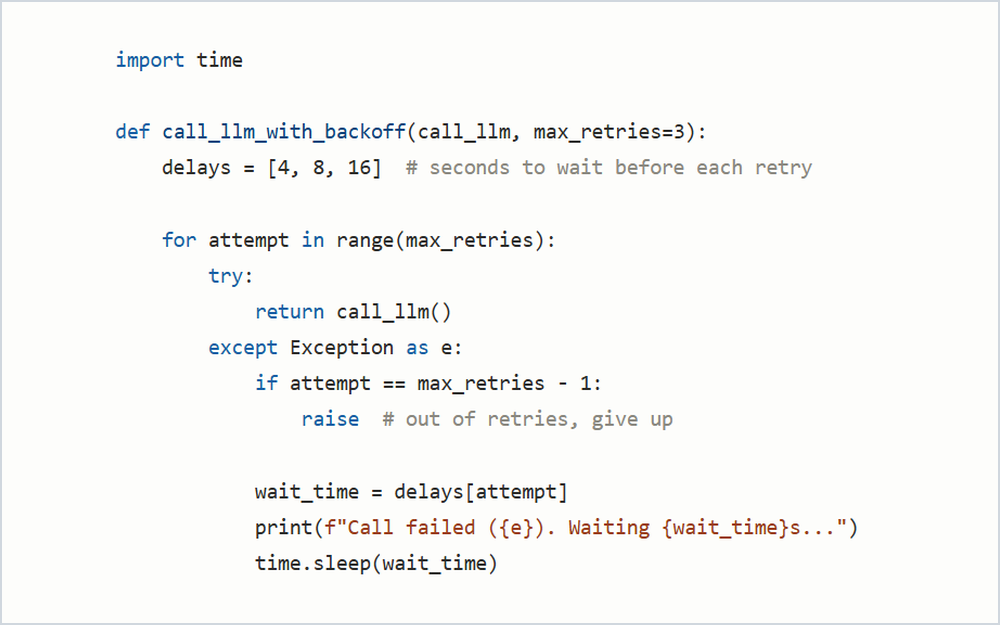
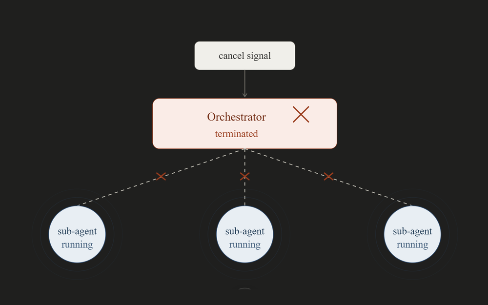
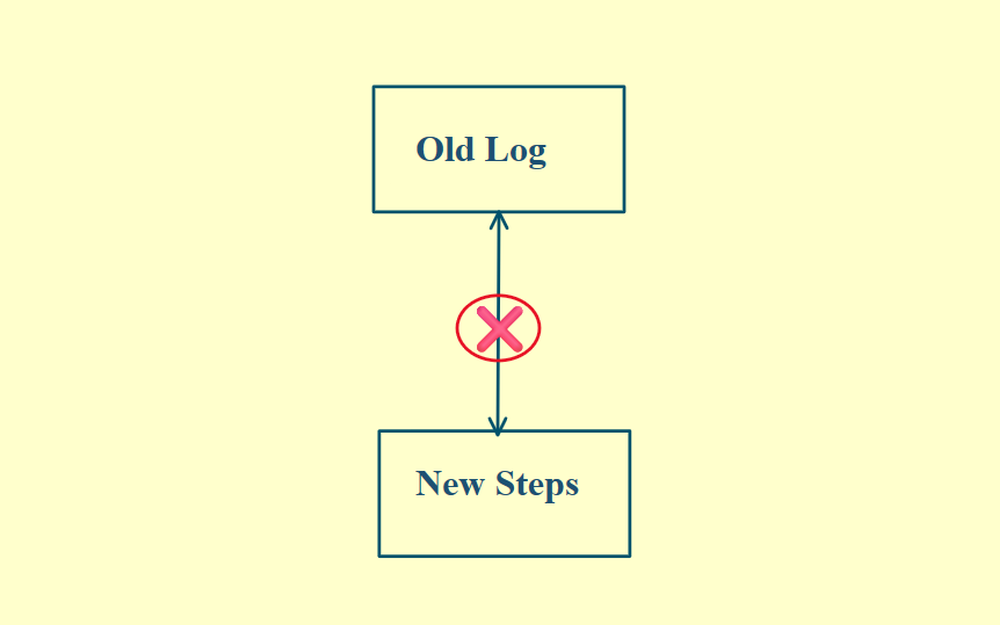
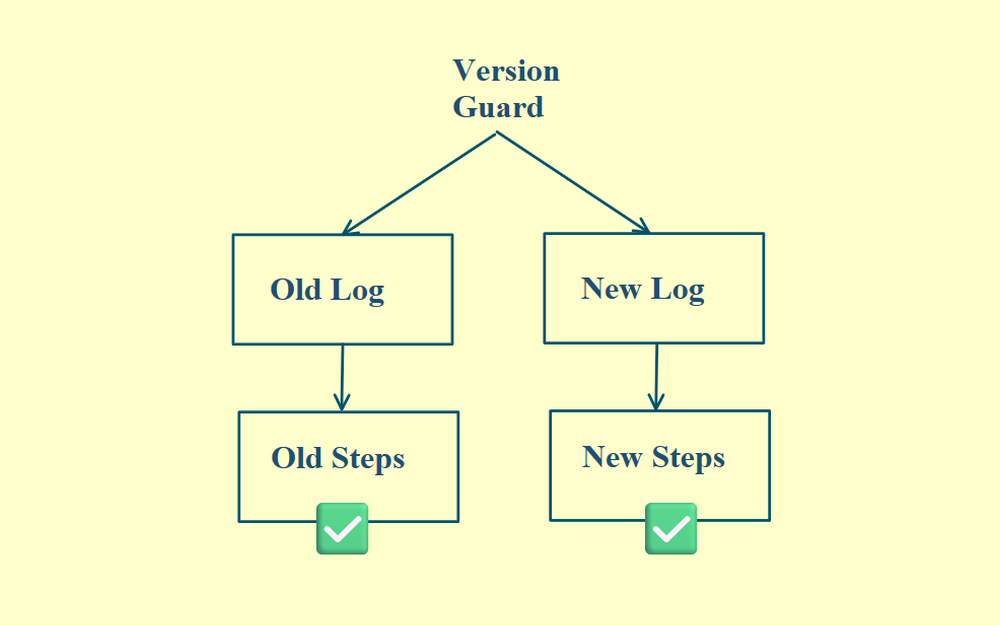

# 09 · Designing for Failure

If you build your AI agent assuming everything will work, it will fail. Design for failure instead. Here are six ways an AI agent breaks in production, and how to handle each.

## 1. LLM API failures

Any LLM API can randomly time out or hit a rate limit. It'll probably work if you retry, just not immediately.

**Fix: exponential backoff.** Wait, then retry: after 4 seconds, then 8, then 16. The wait gives the API time to recover.

  

## 2. Human-in-the-loop stalls

Your agent pauses for approval and waits forever if the reviewer is unavailable.

**Fix: a timeout at the handoff point.** If no signal arrives in time, auto-escalate, auto-approve or auto-reject. Track more than whether the status is pending or done. Track why it moved: approved, escalated or timed out.

## 3. Orphaned child workflows

A user cancels the job and the orchestrator dies, but the sub-agent workflows it spawned keep running. They keep burning API credits and writing to shared state.

  

**Fix: explicit cancellation policies,** so cancellation propagates down to every child.

## 4. Tool call failures

Your agent's tools can crash or error out. Don't let them fail silently.

**Fix: return the error to the LLM** and let it decide what's next. If a file isn't found, the LLM might skip retrying entirely and ask the user for the file.

## 5. Long-running task failures

Some agents run for hours or days. Say a task has 10 steps. The agent finishes 8 in two hours, then fails on step 9. Without checkpoints, those two hours are gone.

**Fix: keep the full history.** Save every prompt, LLM response, tool call and result. Restart with that context and the LLM picks up exactly where it left off, with no redone work.

Loops without a limit can also run forever, burning tokens and money. Enforce a hard maximum iteration count.

## 6. Versioning breakage after updates

Say you deploy an update, like adding a new step, while an old workflow is still mid-run. When that old workflow gets replayed, it runs against the new code. The steps don't match and it crashes.

  

**Fix: a version guard.** Think of it as an if/else. Old workflows follow the old steps and new ones follow the new steps, so both replay correctly, each against the logic it was meant for.

  

