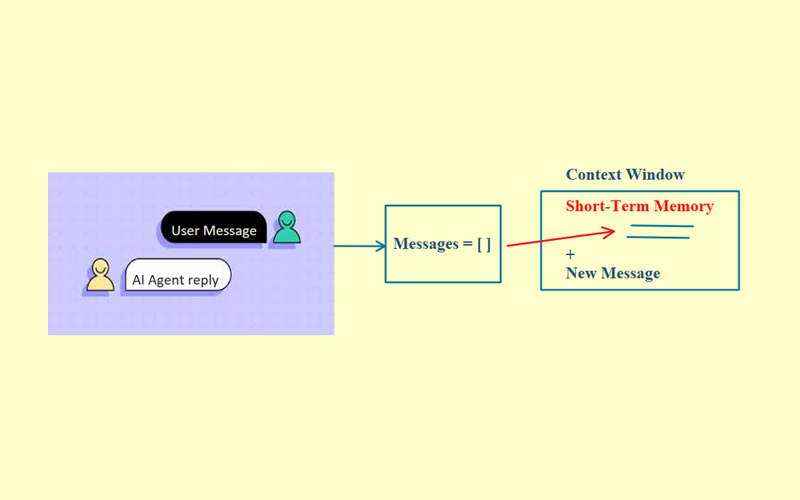
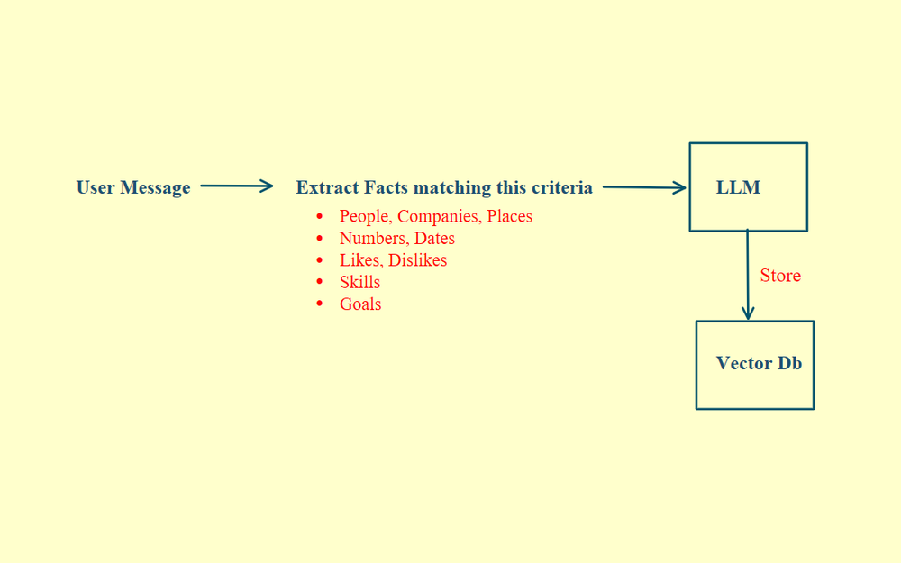
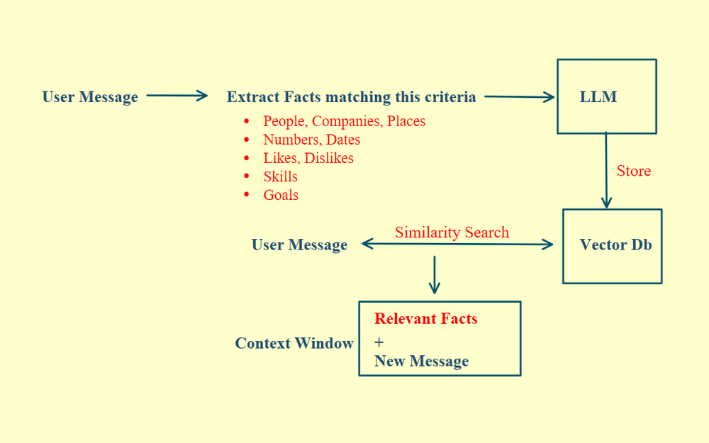
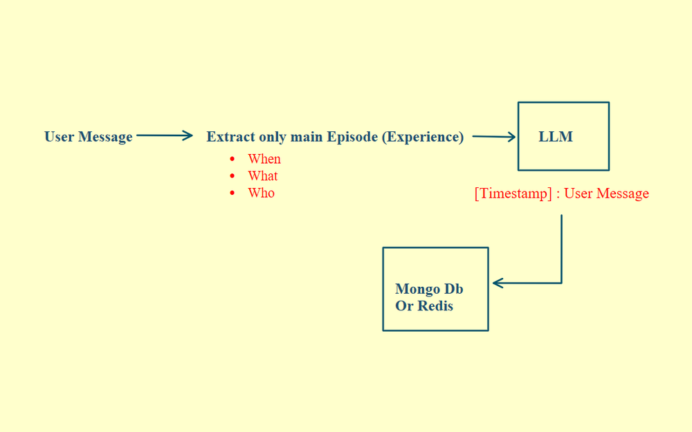
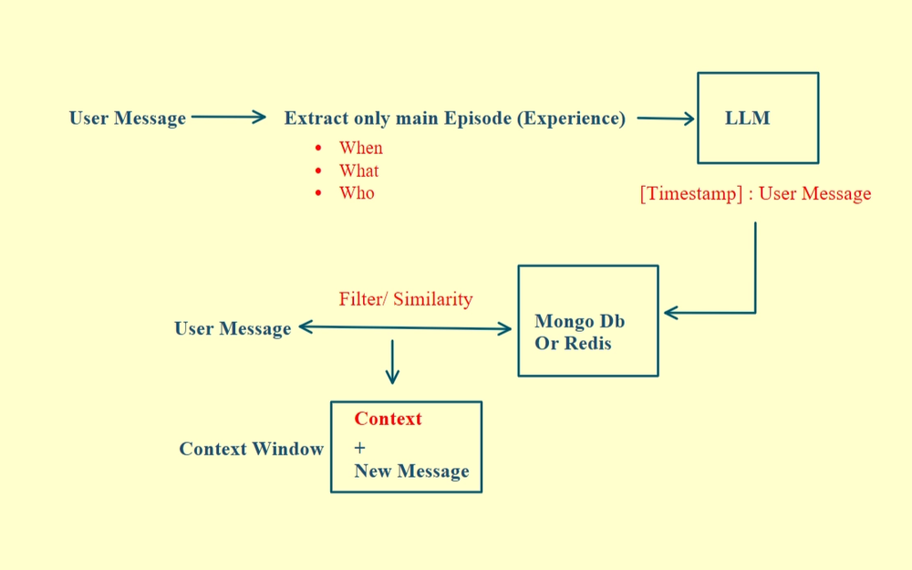
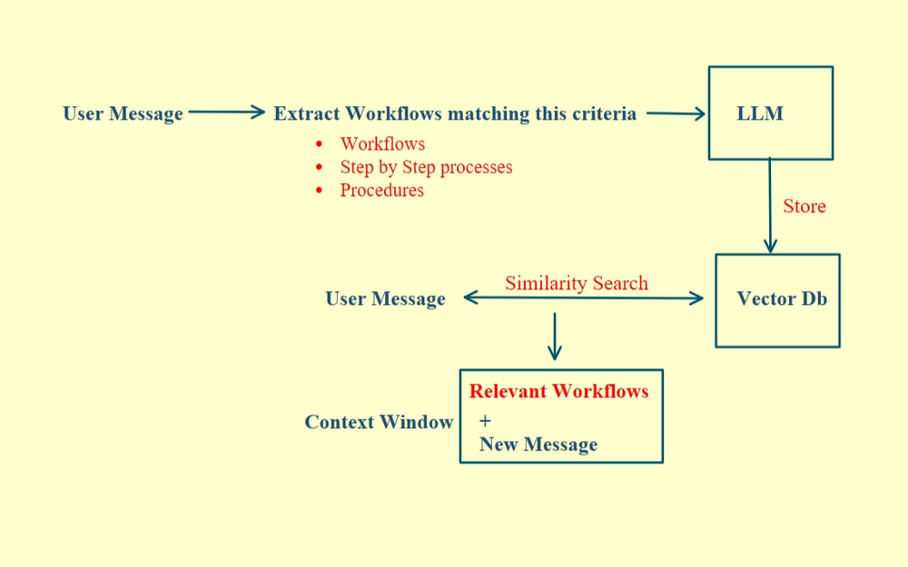

# 10 · Agent Memory

There are four types of memory you need to know to architect memory for an AI agent.

## Short-term memory

Every user and agent message gets appended to a messages array, and that array is sent to the model with every new request. The agent isn't remembering anything. It re-reads the full conversation every time.

  

The problem is that the context window grows with every message, and eventually you hit the model's limit. So you either drop older messages or summarize them.

  

This works well for a single session. For anything beyond that, you need long-term memory.

## Long-term memory

There are three types of long-term memory.

### Semantic memory

Instead of storing raw messages, you use an LLM to extract meaningful facts, like preferences, skills and goals. You convert them into embeddings and store them in a vector database.

  

When the user comes back, you run a similarity search, pull the relevant facts and inject them as context.

  

This sounds like RAG, and the implementation is similar, but the role is completely different.

| Aspect         | RAG                              | Semantic memory                     |
| -------------- | -------------------------------- | ----------------------------------- |
| Nature         | Static                           | Dynamic                             |
| Data source    | Loaded once from docs            | Written mid-conversation            |
| Update trigger | Manual reload                    | Agent learns as it talks            |
| What it stores | Knowledge base content           | User-specific context               |
| Access pattern | Query for facts                  | Recalled automatically next session |
| Role           | Answers questions from knowledge | Keeps the agent coherent over time  |
| Think of it as | A library                        | A diary                             |

### Episodic memory

Instead of facts, episodic memory stores events. Keywords like "attended", "met" and "experienced" signal the LLM to extract and store an episode before answering. It captures what happened, when, with whom and the outcome.

Each episode is stored as a timestamped JSON key-value pair.

  

Retrieval works differently here. Besides searching by similarity, you can filter by time.

  

Semantic memory answers who the user is. Episodic memory answers what happened and when.

### Procedural memory

Procedural memory stores how to do things: the workflows and step-by-step processes the user prefers. The only difference from semantic memory is the extraction prompt. Instead of pulling facts, you pull procedures, the steps involved and when to use each one. Everything else works like semantic memory.

  

