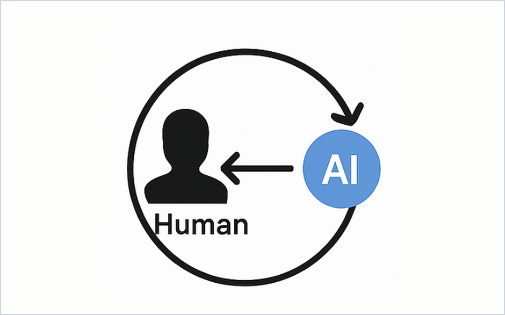
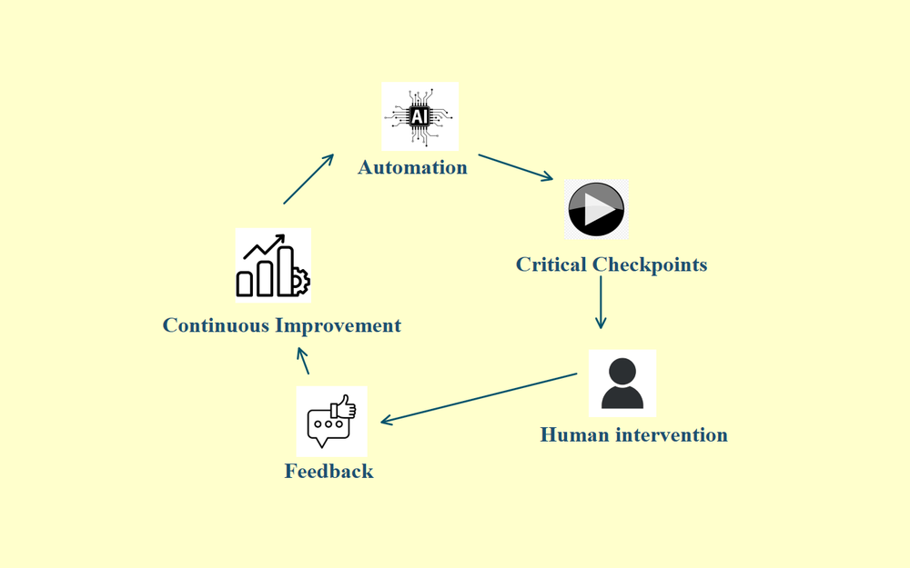
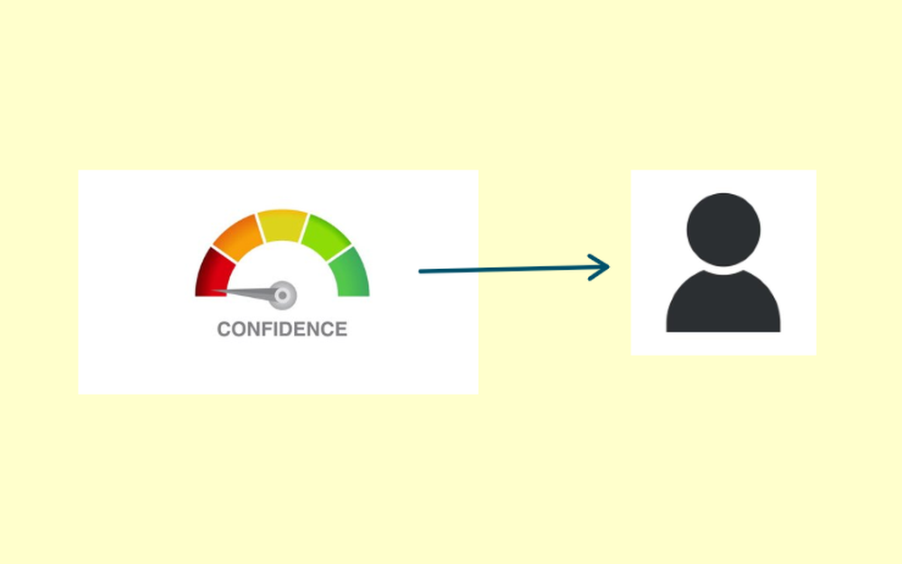
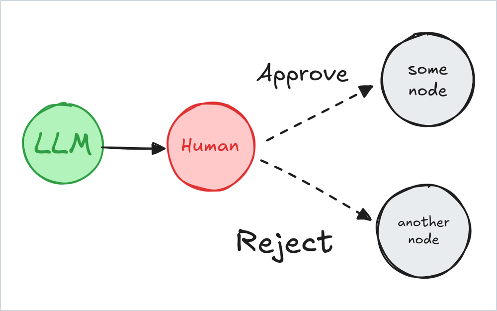

# 11 · Human in the Loop (HITL)

Production AI projects use a human in the loop (HITL) as the trust layer for customers. Instead of letting the AI run as a fully automated system, HITL adds checkpoints where humans review, approve or correct its outputs.

  

## How it works

1. **Automation.** The AI processes data and generates an output.
2. **Critical checkpoints.** At uncertain or high-stakes decision points, the process pauses for human review.
3. **Human intervention.** A human gives feedback, makes a decision or corrects the work.
4. **Incorporating feedback.** The system takes that input and resumes.
5. **Continuous improvement.** The AI learns from it, improving future performance.

  

## Why it matters

- **Accuracy.** Human judgment catches errors the AI alone would miss.
- **Complexity.** AI struggles with ambiguous situations, emotional intelligence and ethical dilemmas.

## Where to put humans in the workflow

The goal is to insert humans where they add value the agent alone can't. Here are three ways to do it.

### 1. Confidence-based escalation

The agent drafts a response and evaluates its own confidence. Only low-confidence responses get escalated to a human.

  

These signals trigger escalation:

- Confidence is below a threshold.
- A policy conflict is detected.
- User sentiment is negative.
- The request falls outside known patterns.

This keeps humans focused on what matters: edge cases, ambiguity and novel situations.

### 2. Guidance on high-stakes decisions

For critical calls, the agent identifies the decision point and presents the action along with its tradeoffs. A human reviews the reasoning, selects the direction and authorizes it. The agent then executes, with the human's decision logged.

  

This keeps the agent doing what it's good at, like data gathering, formatting and tool orchestration. Humans do what they're good at: strategy, priorities and tradeoffs.

### 3. The feedback loop

Every human correction should make the agent smarter. When a human overrides the agent's decision, that correction gets logged with the reasoning behind it, and the agent learns from what humans kept catching.

That's how escalation volume can drop over time, making the system gradually more autonomous.

  

HITL is the design behind AI products that have earned real trust.
