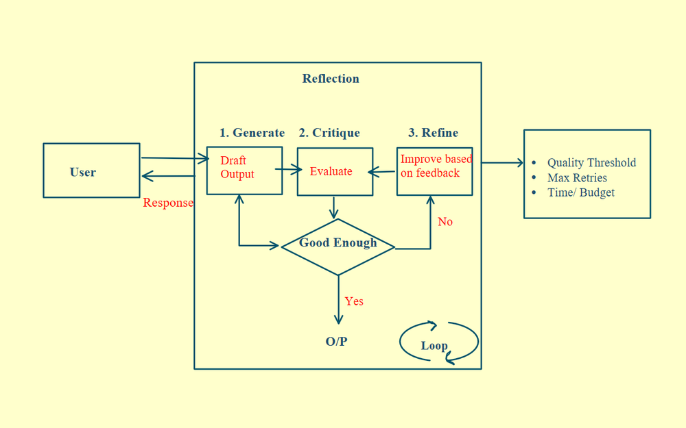
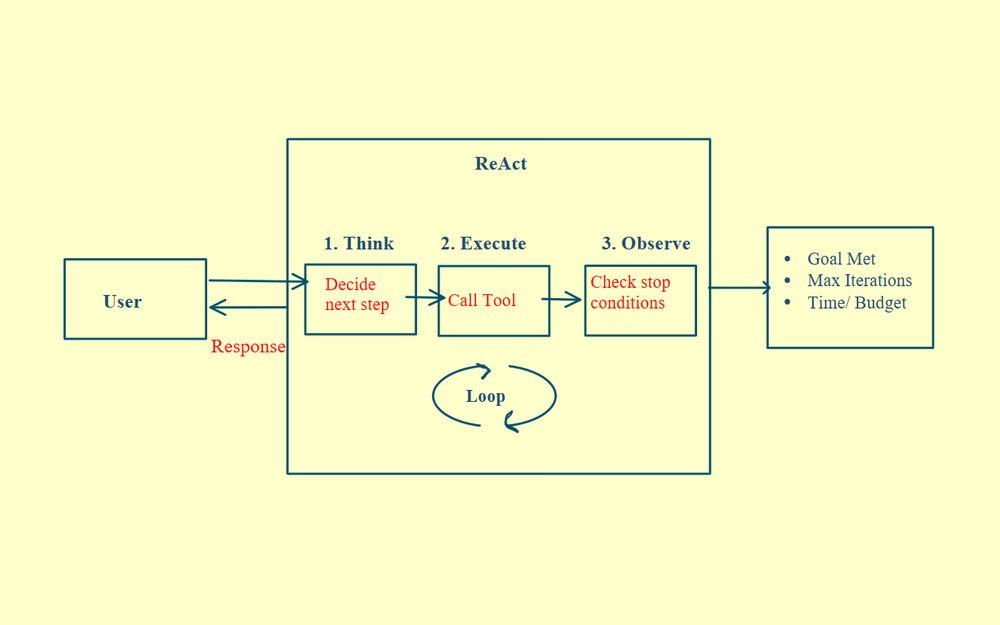
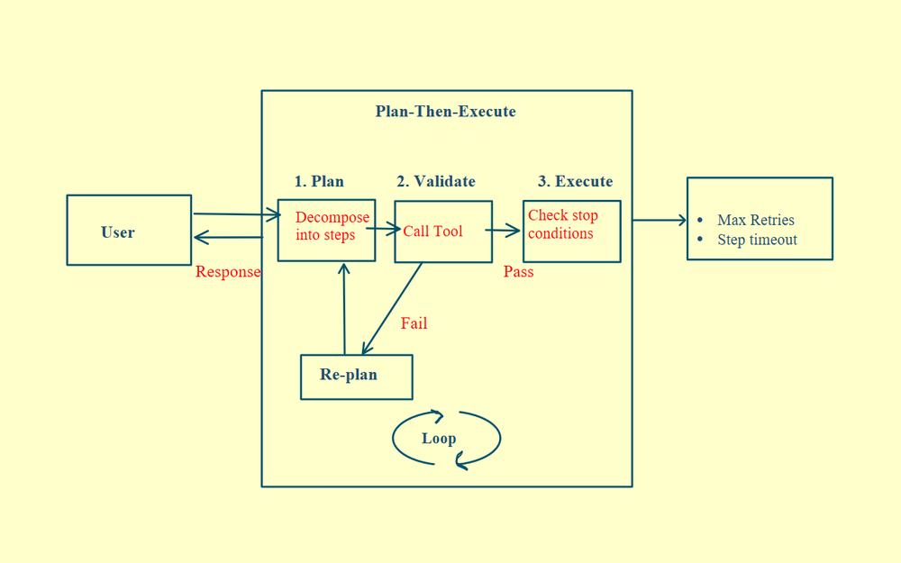

# 12 · Agent Orchestration Patterns

Three orchestration patterns, each with a different strength. Reflection boosts accuracy, ReAct brings transparency and trust, and Plan-Then-Execute completes tasks faster. Here's how each works and how to pick the right one.

## 1. Reflection

The agent generates a first output, judges its own work against your quality bar and rewrites it. It loops until the output is good enough or it hits a limit.

  

The critique is a separate, explicit step. That means you can use a different prompt for it, a stricter model or even a human review in the loop.

**Use it for** high-stakes, quality-critical work, where a first draft was never going to be enough and refinement is the whole point.

## 2. ReAct (Reason + Act)

The agent works in a loop. It reasons about the next step, takes one action and observes what comes back, and that new context shapes what it does next. It acts first to gather information and lets the outcome decide the next step, so the agent learns by doing.

  

**Use it when** you can't predict what you need until you start exploring, and the answer lives inside the execution rather than before it.

Bound the loop with a maximum number of steps and a clear stop condition. Otherwise the agent keeps looping and quietly burns your budget.

## 3. Plan-Then-Execute

This is the opposite approach. The agent builds the entire plan first, then executes it step by step. Steps that don't depend on each other can even run in parallel.

There's a validation step in between. Before anything runs, you check the whole plan and catch missing steps, unreasonable logic and unsafe actions before they ever execute.

  

**Use it when** you can map the steps upfront and the workflow is predictable and deterministic. Plan once, validate the plan and run it.
